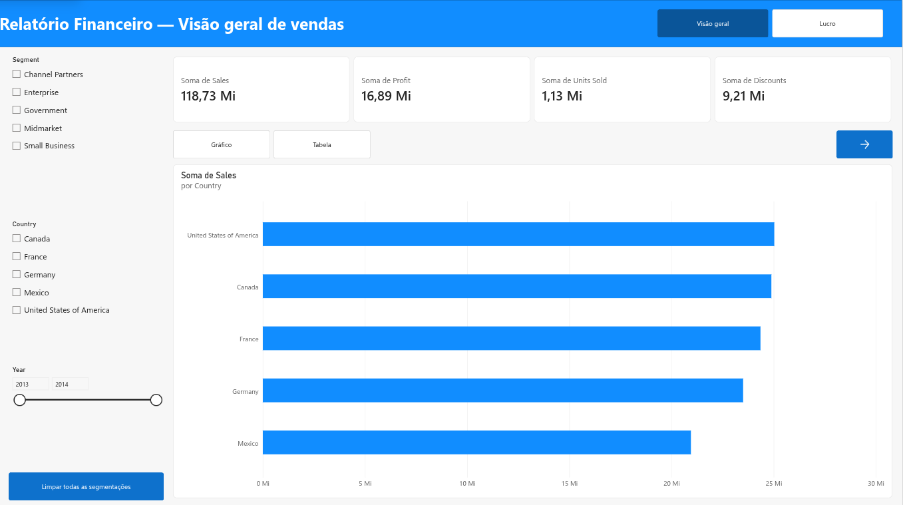
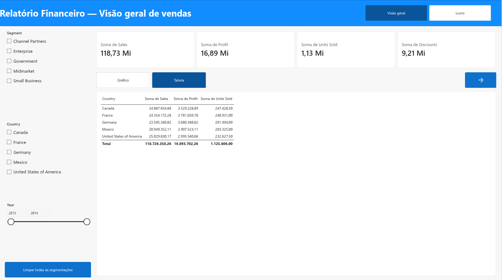
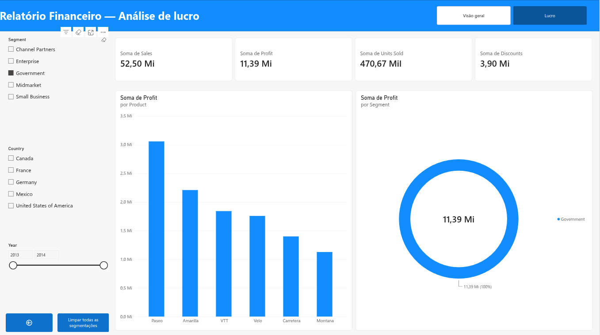

# Relatório financeiro com navegação no Power BI (Financial Sample)

Segundo desafio de projeto do bootcamp de Power BI da DIO. O relatório usa a base **Financial Sample** da Microsoft, disponibilizada no repositório da expert [julianazanelatto/power_bi_analyst](https://github.com/julianazanelatto/power_bi_analyst).

## Objetivo

- Montar um relatório com estrutura definida (cabeçalho, filtros à esquerda, indicadores no topo e área de análise).
- Criar botões de navegação entre as páginas.
- Usar segmentadores de dados e botões com imagem.
- Usar indicadores (bookmarks) e botões para alternar visuais diferentes sobre o mesmo assunto.
- Publicar o relatório no Power BI Service.

## Páginas do relatório

| Página | Conteúdo |
|---|---|
| 1. Visão geral | Cartões (vendas, lucro, unidades vendidas, descontos) e vendas por país, que alternam entre gráfico de barras e tabela |
| 2. Lucro | Os mesmos cartões, lucro por produto (colunas) e lucro por segmento (rosca) |

## Elementos do desafio

| Elemento | Como foi feito |
|---|---|
| Estrutura | Faixa de cabeçalho com o título da página, segmentadores na coluna da esquerda, cartões no topo e a análise principal embaixo |
| Navegação | Navegador de páginas no cabeçalho (Visão geral / Lucro), botão de seta na página 1 que leva à página Lucro e botão Voltar na página 2 |
| Segmentadores | Segment, Country e Year (intervalo de anos) em cada página |
| Botões com imagem | Seta (navegação de página), Voltar e Limpar todas as segmentações |
| Indicadores | Dois indicadores na página 1, **Gráfico** e **Tabela**, que mostram vendas por país como gráfico de barras ou como tabela. Os indicadores não guardam os dados, então trocar de visual não desfaz o filtro aplicado nos segmentadores |

## Prints

### Página 1 – Visão geral (indicador Gráfico)



### Página 1 – Visão geral (indicador Tabela)



### Página 2 – Lucro


### Página 2 – Lucro filtrado pelo segmento Government



## Estrutura

```
dataset/     base Financial Sample (.xlsx)
relatorio/   arquivo .pbix do relatório
imagens/     prints das páginas
```

## Status

- [x] Página 1 com layout, cartões, segmentadores e visuais
- [x] Indicadores e botões para alternar gráfico e tabela
- [x] Segunda página criada
- [x] Botões de navegação entre as páginas
- [x] Relatório publicado no Power BI Service
- [x] Arquivo .pbix salvo em `relatorio/`
- [x] Prints das páginas adicionados

## Ferramentas

Power BI Service (app.powerbi.com).
